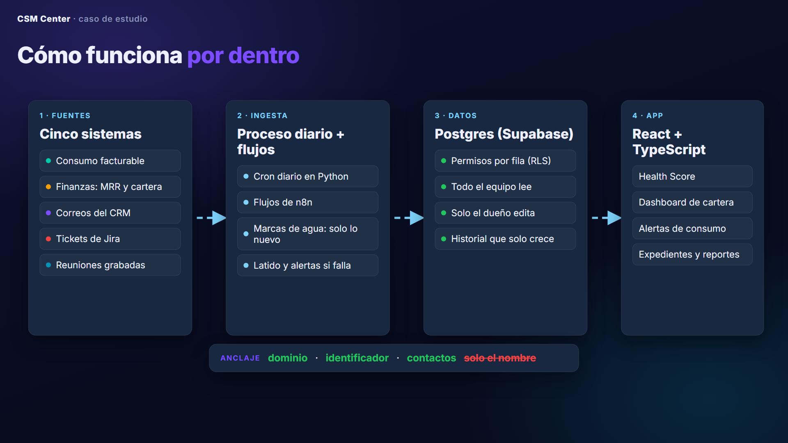
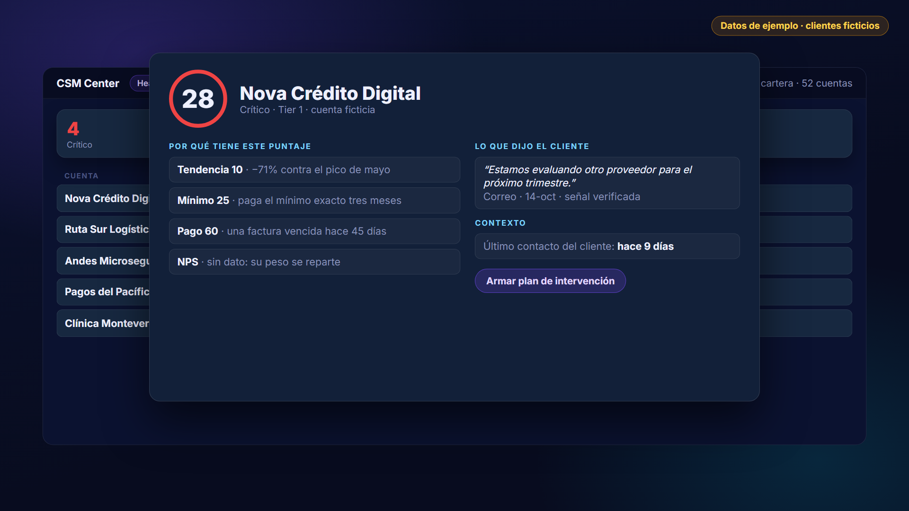
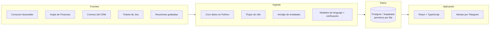
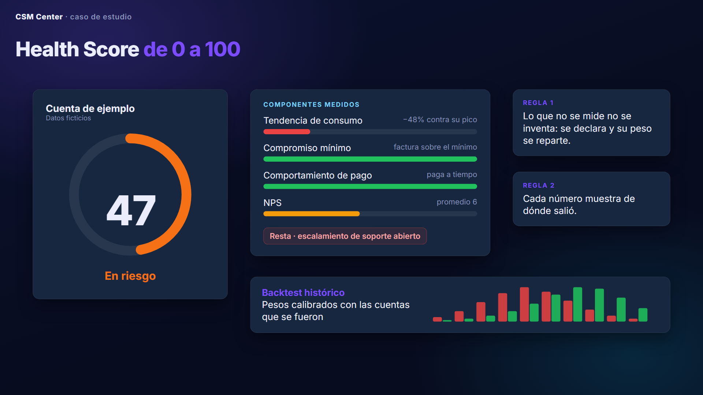
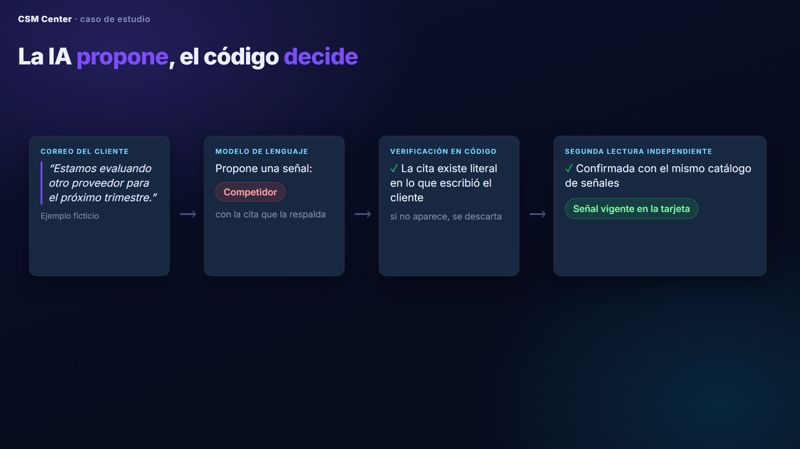

# CSM Center · caso de estudio

**Juan Pablo Mesa · Customer Success**

CSM Center es la plataforma interna que construí para que un equipo de Customer Success de cuatro personas gestione cientos de cuentas B2B con datos y no con intuición. Lo hice en mi rol actual, en una empresa SaaS de identidad digital en Latinoamérica, entre abril y octubre de 2026.

> **Sobre este repositorio.** Es un caso de estudio. No contiene código, datos ni configuración de mi empleador: el texto explica el problema, la arquitectura y las decisiones. Las pantallas y el video usan **clientes ficticios** y se armaron desde cero para esta presentación.

▶ **[Video: cómo funciona por dentro (2 min)](video/csm-center-por-dentro.mp4)**

---

## El problema

La información de cada cliente vivía en cinco lugares:

| Fuente | Qué guarda |
|---|---|
| Data warehouse (ClickHouse y Snowflake) | Consumo: lo que el cliente usa y se le cobra |
| Hojas de Finanzas | MRR, facturas, pagos y mora |
| CRM | Correos con el cliente |
| Jira | Tickets de soporte y escalamientos |
| Reuniones grabadas | Transcripciones y compromisos |

Armar la foto de una cuenta tomaba horas y los riesgos (una caída de consumo, una factura vencida, un cliente que menciona a un competidor) se veían tarde, cuando ya no había margen para actuar.

## Qué construí

| Módulo | Para qué sirve |
|---|---|
| **Health Score** | Puntaje de 0 a 100 por cuenta, con cinco estados y el porqué de cada número. Reemplazó al del CRM. |
| **Dashboard de cartera** | Consumo, MRR y retención (GRR/NRR) por región, tier y CSM, con exportación a Excel. |
| **Alertas de consumo** | Cada semana, cada CSM recibe por Telegram las cuentas que más caen o crecen. |
| **Conoce el cliente** | Un expediente por cuenta: contexto, línea de tiempo, contrato vigente y lo que dijo el cliente, actualizado cada día. |
| **Report Builder** | Reportes mensuales para clientes (MBR) generados en minutos, exportables a PDF y PowerPoint. |
| **Seguimiento y planes de intervención** | Casos automáticos para las cuentas en riesgo y planes con dueño, fecha y resultado. |
| **Asistente de consulta** | Cada CSM pregunta por un cliente en lenguaje natural y recibe una respuesta con fecha y fuente de cada dato. |

*Pantalla recreada con clientes ficticios.*

## Arquitectura

1. **Ingesta.** Un proceso diario en Python (unas 25 etapas) y flujos de n8n traen cada fuente usando marcas de agua: solo lo nuevo desde la última corrida.
2. **Anclaje.** Cada correo, ticket o reunión se asocia a la cuenta correcta por **dominio, identificador del cliente y contactos**, nunca solo por el nombre: un nombre de cliente que es una palabra común (o un verbo en otro idioma) arrastra ruido de otras cuentas.
3. **Datos.** Todo aterriza en Postgres (Supabase) con permisos por fila: todo el equipo lee la cartera completa y solo el dueño de una cuenta edita lo suyo.
4. **Aplicación.** React + TypeScript, desplegada en Netlify y Vercel desde la rama principal.

## El Health Score

- **Componentes:** tendencia de consumo contra su propio pico, compromiso mínimo, comportamiento de pago y NPS, con penalizaciones por mora, escalamientos de soporte o caídas sostenidas.
- **Regla 1 · nunca imputar.** Lo que no se mide no se inventa: se declara en la tarjeta y su peso se reparte entre lo medido. Un cero medido no es lo mismo que un dato faltante.
- **Regla 2 · cada número con su porqué.** La tarjeta de cada cuenta muestra de dónde salió cada componente.
- **Calibración.** Los pesos salen de un backtest con más de 2.000 observaciones mensuales, incluidas las cuentas que se fueron: medir solo a las que se quedan sesga el modelo.
- **Lo cualitativo no puntúa, pero se ve.** Lo que dijo el cliente aparece en la tarjeta con su cita, separado del número.

## La IA propone, el código decide

Un modelo de lenguaje lee cada correo y reunión nueva y propone señales: un competidor, una queja, un pedido pendiente, una salida. El código decide si entran:

- La cita tiene que existir **literal** en lo que escribió o dijo el cliente, no en el resumen automático de la reunión ni en la parte citada de un correo.
- Toda señal nueva pasa por una **segunda lectura independiente** con el mismo catálogo de definiciones.
- Cada semana, un juez distinto mide la precisión por tipo de señal y oculta el tipo que no alcance el umbral.

La regla que más me costó aprender: **lo que se puede calcular no se le pide al modelo.** Le pido datos (una cita, un identificador, una fecha) y el código hace las cuentas, ordena y aplica los límites.

## Decisiones de ingeniería que más me enseñaron

- **Una fuente oficial por métrica.** El consumo que ve la plataforma sale del mismo sistema con el que se factura, y se reconcilia contra lo que ve el cliente, no contra otra tabla interna.
- **El costo estaba en el fan-out, no en la ventana.** El paso más lento del proceso diario hacía 2.261 llamadas HTTP, una por cliente. Pasarlo a un solo barrido lo dejó en 71 llamadas, y el proceso completo bajó de casi una hora a unos 20 minutos.
- **Pruebas diferenciales y en sombra.** Antes de cambiar el pipeline, la versión nueva corre sin escribir y se compara contra la vieja salida por salida. Una diferencia se explica o no sale.
- **Un chequeo que nunca corre se ve igual que uno que no encontró nada.** Cada verificación tiene casos de control con errores inyectados para probar que de verdad mira.
- **Escribir nunca borra lo verificado.** Un proceso de inventario puede agregar información, pero no pisar lo que una lectura humana ya confirmó.
- **Observabilidad.** Cada proceso escribe un latido. Un vigilante avisa por Telegram si algo no corrió, y otro avisa antes, para que el equipo que lo ejecuta esté encendido.
- **Seguridad.** Webhooks que exigen la sesión del usuario, funciones privilegiadas cerradas al acceso anónimo y una revisión de credenciales que frena cualquier respaldo antes de subirlo.

## Cómo se construyó

| Periodo | Qué salió |
|---|---|
| Abr-may 2026 | Report Builder (MBR) y alertas semanales de consumo |
| May-jun 2026 | Dashboard de cartera y repositorio de consultas |
| Jul-ago 2026 | Capa financiera (MRR, facturación, churn) y retención GRR/NRR para toda la cartera |
| Sep 2026 | Expedientes automáticos por cuenta y el pipeline diario de ingesta |
| Sep-oct 2026 | Health Score propio, señales del cliente con IA y planes de intervención |
| Oct 2026 | Asistente de consulta para los CSMs y endurecimiento de seguridad |

Lo construí con **Claude Code como copiloto**. Yo definí el problema y las reglas de negocio, validé cada número contra su fuente y decidí qué salía a producción; Claude Code escribió y refactorizó buena parte del código bajo esas reglas, y documentó cada decisión para no repetir errores.

**Stack:** React + TypeScript (Vite) · Postgres / Supabase · n8n · Python · ClickHouse · Snowflake · modelos de lenguaje (extracción y verificación) · Telegram · Netlify y Vercel.

## Qué haría distinto

- Versionar el pipeline de datos desde el día uno: vivió semanas solo en una máquina.
- Sacar el proceso diario de un computador personal a un servidor con reintentos.
- Definir el catálogo de señales del cliente con el equipo antes de construir el extractor, no después.

## Contenido del repositorio

| Ruta | Qué es |
|---|---|
| `video/csm-center-por-dentro.mp4` | El video de 2 minutos |
| `video/escenas.html` | Las escenas del video: una página que se dibuja cuadro a cuadro |
| `video/guion.json`, `video/voz.py` | El guion y la narración (voz sintética, edge-tts) |
| `video/render.cjs` | Render cuadro a cuadro con Playwright y ffmpeg |
| `docs/` | Imágenes de este README |

Todos los nombres de clientes, cifras de cuentas y citas que aparecen en las pantallas y el video son **ficticios**.
